# tfplan-guard

tfplan-guard reads the JSON form of a Terraform plan and reports the changes a reviewer should stop on: databases, buckets and keys that will be destroyed or replaced, security groups opened to the internet on admin and database ports, IAM policies that allow everything, public buckets, unencrypted storage, and unusually large deletions. It reads the plan, never touches state or the cloud.



**Live demo:** https://jvch0512.github.io/tfplan-guard/ (A synthetic plan with a mix of risky and safe changes.)

Go 1.22+, standard library only. The demo page is rendered from the tool's `--tsv` output by `scripts/site.py` (Python 3, only needed to regenerate the page).

## Use

```bash
terraform plan -out=tfplan && terraform show -json tfplan > plan.json
go build -o tfplan-guard ./cmd/tfplan-guard
./tfplan-guard plan.json
./tfplan-guard plan.json --tsv
./tfplan-guard plan.json --fail-on high      # exit 1 in the pipeline, before apply
```

`-` reads the plan from standard input.

| Rule | Severity | What it catches |
|---|---|---|
| TF001 | critical | destroy or replace of a stateful resource: databases, buckets, KMS keys, volumes, file systems, tables |
| TF002 | high | security group ingress from `0.0.0.0/0` or `::/0` on SSH, RDP or database ports, or on all ports |
| TF003 | high | IAM policy allowing `Action: *` on `Resource: *` |
| TF004 | high | public bucket ACL (`public-read`, `public-read-write`) or public access block switched off |
| TF005 | medium | storage created or changed without encryption (RDS, EBS) |
| TF006 | medium | RDS instance with `publicly_accessible` |
| TF007 | medium | bulk deletion: 10 or more resources destroyed in one plan |

See [examples](examples) and [docs/sample-output.txt](docs/sample-output.txt).

## Limits

- AWS resource types are covered in depth, others only by the generic destroy rules (TF001 list and TF007).
- It reads values known at plan time. Values that are only known after apply cannot be judged.
- Policy documents are read when they are JSON strings in the plan. Policies built from data sources may be unknown until apply.
- It is a review aid, not a replacement for policy engines such as OPA or Sentinel. It works with no setup, which is its point.

## Where it fits

Infrastructure change review and CI gates: stop the plan that would drop a production database or open port 22 to the world, with no policy language to learn.

## Tests

```bash
make test    # 16 Go tests (go vet + go test)
```

MIT.

## Code scanning (SARIF)

`scripts/tsv2sarif.py` converts the `--tsv` output into SARIF 2.1.0, so findings show up in GitHub code scanning:

```sh
./tfplan-guard examples/plan.json --tsv | python3 scripts/tsv2sarif.py --tool tfplan-guard --prefix examples > results.sarif
```

Upload `results.sarif` with `github/codeql-action/upload-sarif`. Severities map to SARIF levels (critical and high to error, medium to warning, low and info to note) and to a `security-severity` score.
